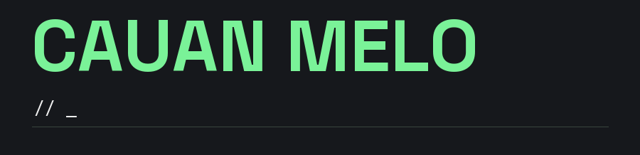

# Cauan Melo

Desenvolvo sistemas web, painéis administrativos e APIs REST. Trabalho desde a modelagem do banco de dados até a interface, as integrações e a implantação.

[Portfólio](https://cauan.dev/) · [Currículo](https://cauan.dev/curriculo.pdf) · [LinkedIn](https://www.linkedin.com/in/cauan-melo-a050b61a9/)

## Tecnologias

Python · FastAPI · PHP · Laravel · React · TypeScript · PostgreSQL · MySQL
