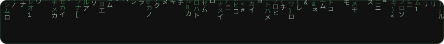

Desenvolvo sistemas web, painéis administrativos e APIs REST, da modelagem do banco de dados à interface, integrações e implantação. Em fase final de Análise e Desenvolvimento de Sistemas, buscando minha primeira oportunidade como desenvolvedor, em regime remoto.

[Portfólio](https://cauan.dev/) · [Currículo](https://cauan.dev/curriculo.pdf) · [LinkedIn](https://www.linkedin.com/in/cauan-melo-a050b61a9/)

## Stack

<picture>
  <source media="(prefers-color-scheme: dark)" srcset="assets/stack-dark.svg">
  <source media="(prefers-color-scheme: light)" srcset="assets/stack-light.svg">
  
</picture>

## Projetos

**[Estrutura Pública](https://estruturapublica.com.br/)**
Plataforma SaaS multi-tenant de gestão de pessoas e folha de pagamento para órgãos públicos de Alagoas. Gera os arquivos do SIAP/TCE-AL, guarda o histórico de cada alteração para auditoria e inclui aplicativo para Windows, Portal da Transparência e painel administrativo. Em desenvolvimento, código privado.
`Python` `FastAPI` `PostgreSQL` `Redis` `React` `TypeScript` `Electron` `Docker`

**Widget Monitor**
Widget de desktop para Windows que fica fixo na área de trabalho e mostra, em tempo real, temperatura, uso e frequência de CPU e GPU, RAM, disco, rede e bateria. Inclui overlay para jogos e página para acompanhar pelo celular.
`Python` `PySide6` `psutil` `PyInstaller`

